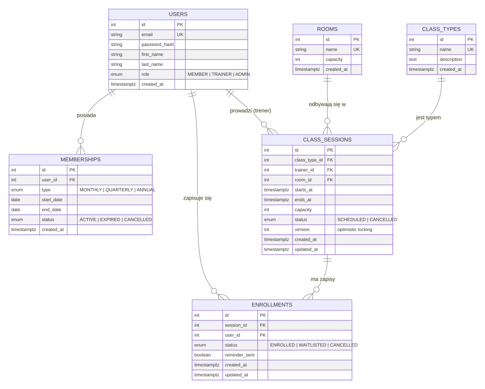
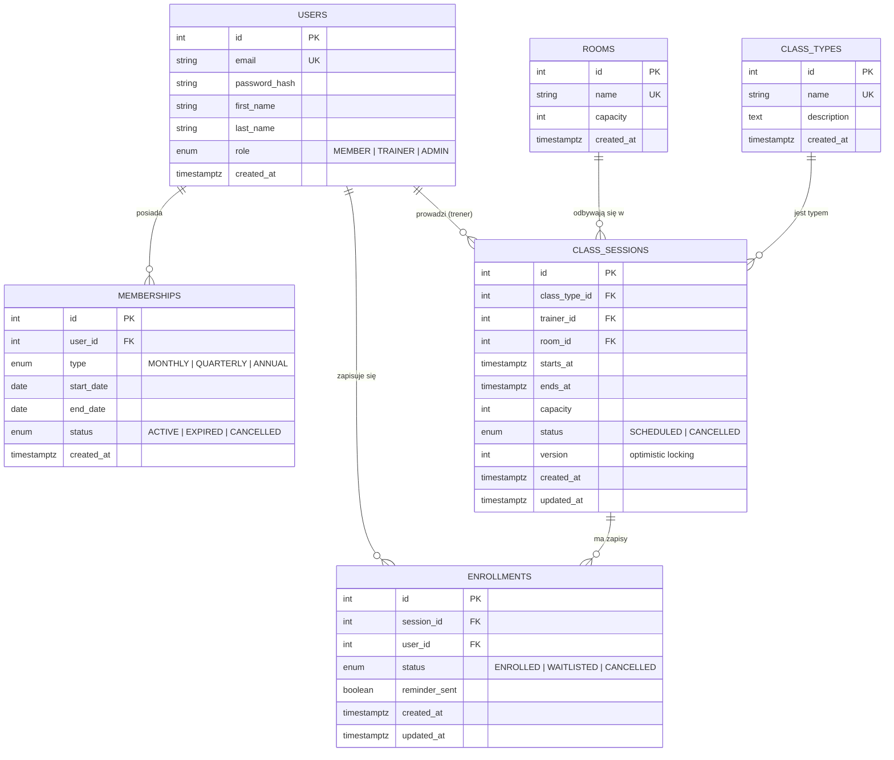

# Model danych (ERD)

## Relacje

| Relacja | Typ | Opis |
|---|---|---|
| users → memberships | 1:N | Członek może mieć wiele karnetów (historia), ale tylko jeden aktywny w danym okresie. |
| users → enrollments | 1:N | Członek może mieć wiele zapisów. |
| users → class_sessions | 1:N | Trener (użytkownik z rolą TRAINER) prowadzi wiele zajęć. |
| rooms → class_sessions | 1:N | W sali odbywa się wiele zajęć (nigdy dwa w tym samym czasie). |
| class_types → class_sessions | 1:N | Typ zajęć (np. Yoga) ma wiele terminów w grafiku. |
| class_sessions → enrollments | 1:N | Zajęcia mają wielu uczestników i listę rezerwową. |

`users` ↔ `class_sessions` przez `enrollments` to relacja wiele-do-wielu z dodatkowymi danymi (status, kolejność na liście rezerwowej).

## Ograniczenia w bazie

- `UNIQUE (session_id, user_id) WHERE status <> 'CANCELLED'`: jeden aktywny zapis użytkownika na dane zajęcia.
- `CHECK (ends_at > starts_at)`, `CHECK (capacity > 0)`, `CHECK (end_date >= start_date)`.
- `ON DELETE RESTRICT` dla sal, typów zajęć i trenerów (nie można usunąć sali, w której są zajęcia).
- `ON DELETE CASCADE` dla zapisów i karnetów (usunięcie użytkownika usuwa jego dane).
